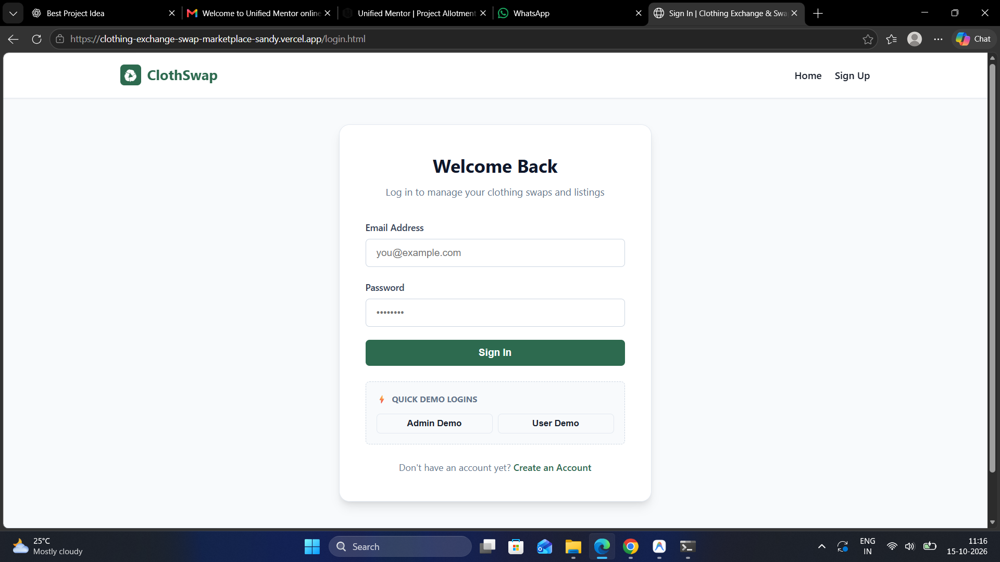
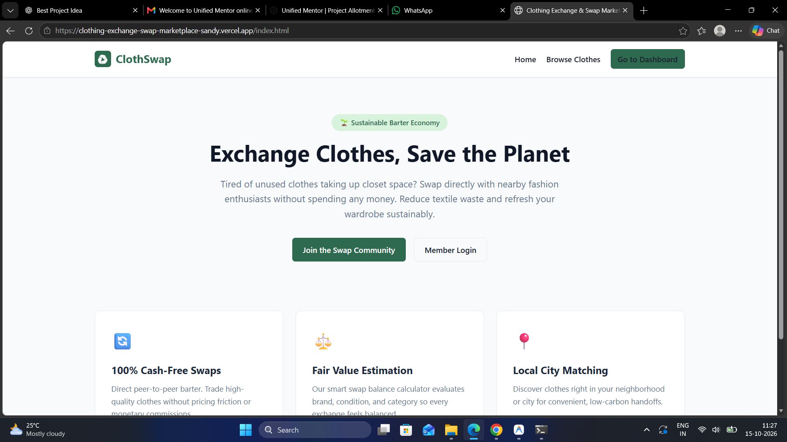
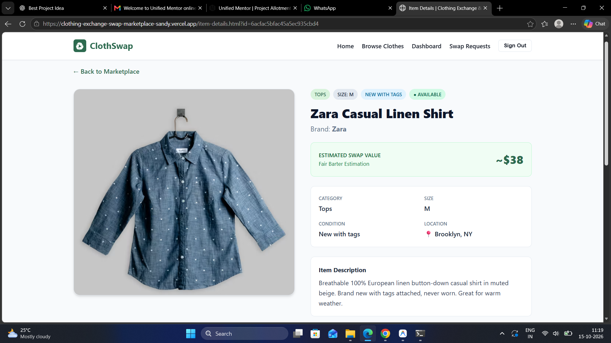
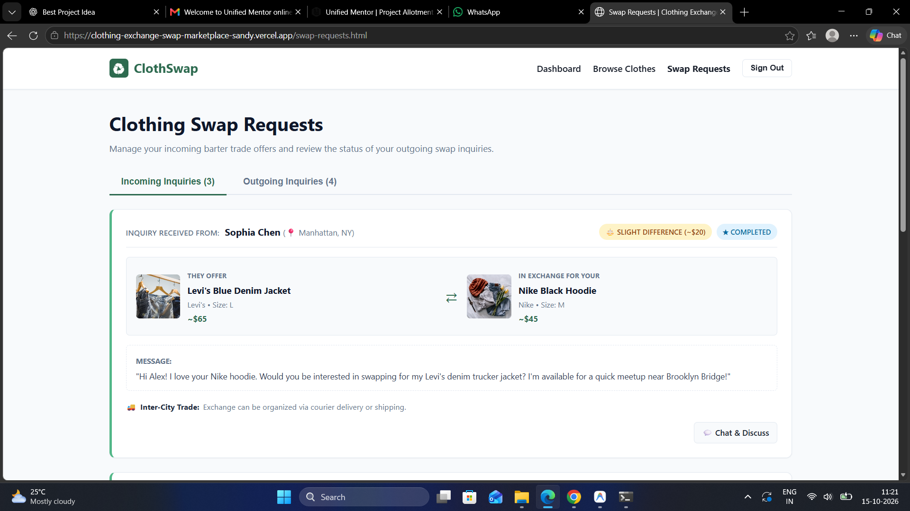
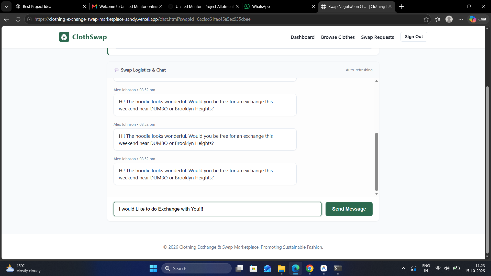
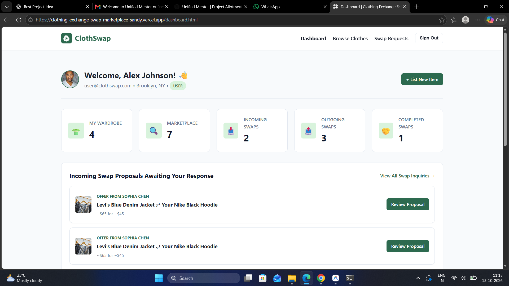
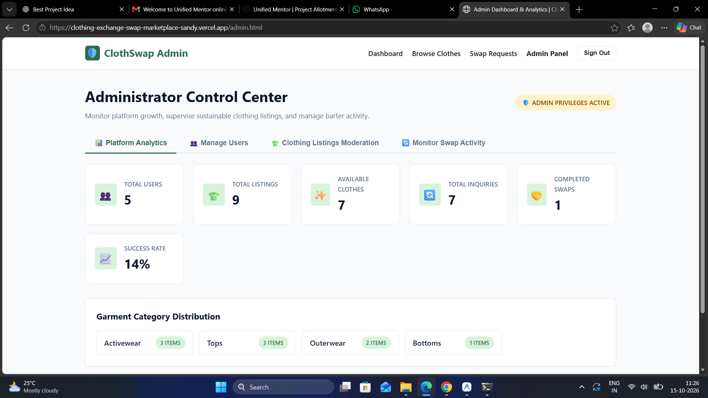

# ♻️ Clothing Exchange & Swap Marketplace

> A sustainable fashion platform that allows users to exchange pre-owned clothing instead of buying new items — promoting clothing reuse and reducing textile waste.

<p align="center">

  **🌐 Live Website:** [Visit Marketplace](https://clothing-exchange-swap-marketplace-sandy.vercel.app/login)

  **⚙️ Backend API:** [View API](https://clothing-exchange-backend.vercel.app)

  **💚 Health Check:** [Check Backend Status](https://clothing-exchange-backend.vercel.app/api/health)

</p>

---

## 📌 Overview

**Clothing Exchange & Swap Marketplace** is a full-stack web application designed to encourage sustainable fashion through a simple clothing exchange system.

Users can create accounts, list pre-owned clothing, browse available items, send swap requests, and communicate with other users. The platform provides an alternative to purchasing new clothes by encouraging the reuse of existing garments.

The project was developed over a **5-day development sprint** using HTML, CSS, JavaScript, Node.js, Express.js, and MongoDB.

## ✨ Features

### 👤 User Authentication
- User registration and login
- Secure password handling
- Authentication-based access to platform features

### 👕 Clothing Listings
- Add and manage clothing items
- Browse available clothing
- View item details
- Search and filter listings where supported

### 🔄 Clothing Swap System
- Send swap requests to other users
- Accept or reject requests
- Track swap request statuses
- Exchange clothing without monetary transactions

### 💬 Chat and Communication
- Communicate with other users about swaps
- Discuss clothing exchange details
- Coordinate exchange requests

### 📊 User Dashboard
- Manage clothing listings
- View swap requests
- Track exchange activities

### 🛡️ Admin Panel
- Manage platform users
- Monitor clothing listings
- Manage swap activities
- Access administrative features

### ⏳ Loading Spinner
- CSS-based loading animation
- Displays during asynchronous network requests
- Improves the user experience while data loads

## 🛠️ Tech Stack

| Technology | Purpose |
|---|---|
| HTML5 | Web page structure |
| CSS3 | Styling and responsive layouts |
| JavaScript | Frontend functionality and API requests |
| Node.js | Backend JavaScript runtime |
| Express.js | REST API and server-side routing |
| MongoDB Atlas | Cloud database |
| Mongoose | MongoDB object modeling |
| bcrypt/bcryptjs | Password hashing, as configured |
| JWT | Token-based authentication, where implemented |
| Mocha | Automated testing |
| Vercel | Application deployment |
| Git & GitHub | Version control and source code hosting |

## 🏗️ Project Architecture

The application follows a client-server architecture.

```text
                 User Browser
                      |
                      v
        Frontend (HTML, CSS, JavaScript)
                      |
                      | HTTPS / REST API
                      v
           Backend (Node.js + Express.js)
                      |
                      v
                MongoDB Atlas
```

### How It Works

1. Users interact with the frontend through a browser.
2. The frontend sends requests to the backend API.
3. The backend processes requests and validates data.
4. MongoDB stores and retrieves application data.
5. The backend returns responses to the frontend.

## 📸 Screenshots

Explore the main pages and features of the Clothing Exchange & Swap Marketplace.

### 🔐 Login Page



### 🏠 Clothing Listings / Home Page



### 👕 Clothing Item Details



### 🔄 Swap Request Management



### 💬 Chat and Communication



### 📊 User Dashboard



### 🛡️ Admin Panel



> **Note:** Add your actual screenshots to the `screenshots/` folder in the repository root using the filenames shown above. GitHub will display the images after you commit and push them.

## 📁 Project Structure

```text
Clothing-Exchange-Swap-Marketplace/
│
├── backend/
│   ├── routes/              # API route definitions
│   ├── models/              # MongoDB/Mongoose models
│   ├── middleware/          # Request middleware
│   └── server.js            # Express server entry point
│
├── frontend/
│   ├── css/                 # Stylesheets
│   │   └── spinner.css
│   ├── js/                  # Client-side JavaScript
│   │   └── spinner.js
│   └── *.html               # Frontend pages
│
├── scratch/
│   └── test-day5.js          # Test file, if retained
│
├── screenshots/              # Application screenshots
│   ├── login.png
│   ├── home.png
│   ├── item-details.png
│   ├── swap-requests.png
│   ├── chat.png
│   ├── dashboard.png
│   └── admin-panel.png
│
├── .env.example              # Environment variable template
├── package.json              # Project scripts and dependencies
└── README.md                 # Project documentation
```

> **Note:** Adjust the structure and filenames above to match the actual files in your repository.

## 🚀 Getting Started

Follow these steps to run the project locally.

### Prerequisites

- [Node.js](https://nodejs.org/)
- npm (included with Node.js)
- [MongoDB Atlas](https://www.mongodb.com/cloud/atlas) account or a compatible MongoDB instance
- [Git](https://git-scm.com/)

### 1. Clone the Repository

```bash
git clone https://github.com/madhurkamble/Clothing-Exchange-Swap-Marketplace.git
cd Clothing-Exchange-Swap-Marketplace
```

### 2. Install Dependencies

Install dependencies from the directory containing the relevant `package.json`.

For the root project, if applicable:

```bash
npm install
```

If the backend has a separate `package.json`:

```bash
cd backend
npm install
```

### 3. Configure Environment Variables

Create a `.env` file in the directory expected by the backend and configure the variables used by your application.

Example:

```env
MONGODB_URI=your_mongodb_connection_string
JWT_SECRET=your_secure_secret
NODE_ENV=development
```

Use `.env.example` as the reference for the actual variable names required by the application.

**Important:** Never commit your real database credentials or JWT secret to GitHub.

### 4. Start the Application

From the directory containing the appropriate `package.json`, run:

```bash
npm start
```

If running locally with the supplied configuration, open:

**http://localhost:5000**

If the frontend is served separately, start it using the instructions for the frontend directory and configure its API base URL to point to the backend.

## 🌐 Live Deployment

The project is deployed using Vercel, with the frontend and backend hosted separately.

| Component | Link |
|---|---|
| Frontend | [Open Website](https://clothing-exchange-swap-marketplace-sandy.vercel.app/login) |
| Backend API | [Open Backend API](https://clothing-exchange-backend.vercel.app) |
| Health Check | [Check API Health](https://clothing-exchange-backend.vercel.app/api/health) |
| Source Code | [GitHub Repository](https://github.com/madhurkamble/Clothing-Exchange-Swap-Marketplace) |

### Backend API Groups

The backend exposes the following API groups:

| Endpoint | Description |
|---|---|
| `/api/health` | Health and database status |
| `/api/auth` | Authentication operations |
| `/api/clothing` | Clothing listing operations |
| `/api/swaps` | Swap request operations |
| `/api/chat` | Messaging operations |
| `/api/admin` | Administrative operations |

These are endpoint groups; the specific routes and HTTP methods depend on the backend implementation.

### Vercel Environment Configuration

Configure the required environment variables in the backend project's Vercel dashboard.

- `MONGODB_URI` — MongoDB Atlas connection string
- `JWT_SECRET` — secure token-signing secret, if required
- `NODE_ENV` — set to `production` for the production environment

After changing environment variables, redeploy the application if necessary.

### MongoDB Atlas Setup

1. Create a MongoDB Atlas cluster.
2. Create a database user with an appropriately restricted role.
3. Configure network access according to your deployment requirements.
4. Obtain the MongoDB connection string.
5. Add it to Vercel as `MONGODB_URI`.
6. Verify the database connection using the deployed health-check endpoint.

Avoid leaving unrestricted database network access enabled longer than necessary.

## 🧪 Testing

The project includes a Mocha test suite for checking API functionality.

Run the configured test command from the directory containing the relevant `package.json`:

```bash
npm test
```

The supplied test setup covers areas including:

- Authentication
- Clothing listings
- Swap requests
- Chat functionality
- Admin routes

The test script and test file paths should match the current repository. Run the tests to confirm the current result rather than assuming all tests pass.

## 🔐 Security Considerations

- Hash user passwords before storing them.
- Protect privileged routes with authorization checks.
- Validate incoming API requests.
- Store credentials in environment variables.
- Restrict MongoDB access and use least-privilege credentials.
- Configure CORS for the intended frontend origin.
- Never expose secrets in frontend JavaScript or public repositories.
- Use HTTPS for production frontend-to-backend communication.

## 🎯 Project Objectives

- Encourage sustainable fashion and clothing reuse.
- Reduce textile waste.
- Provide a convenient platform for exchanging clothes.
- Build practical experience with full-stack web development.
- Demonstrate authentication, REST APIs, database integration, and deployment.

## 🔮 Future Enhancements

- Email notifications for swap requests
- Improved location-based clothing matching
- User ratings and reviews
- Enhanced search and filtering
- Dispute management and moderation
- Additional analytics and reporting
- More automated integration tests

## 🤝 Contributing

Contributions and suggestions are welcome.

1. Fork the repository.
2. Create a feature branch.
3. Make and test your changes.
4. Commit your changes.
5. Open a pull request describing the improvements.

## 📄 License

Add a `LICENSE` file to the repository to specify the license under which this project is distributed.

## 👨‍💻 Author

**Madhur Kamble**

- GitHub: [@madhurkamble](https://github.com/madhurkamble)
- LinkedIn: [Madhur Kamble](https://www.linkedin.com/in/madhur-kamble-55911b290)

---

⭐ If you find this project useful, consider starring the repository!

**Live Demo:** [Clothing Exchange & Swap Marketplace](https://clothing-exchange-swap-marketplace-sandy.vercel.app/login)
